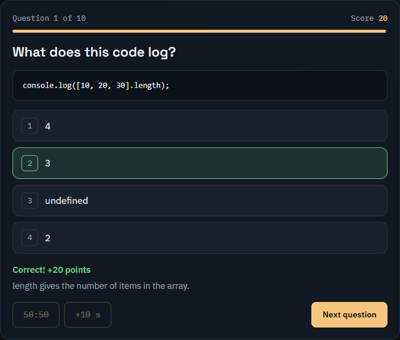
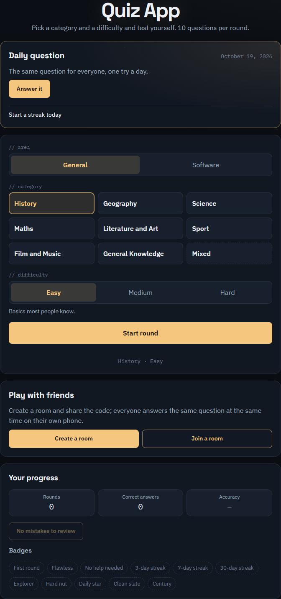
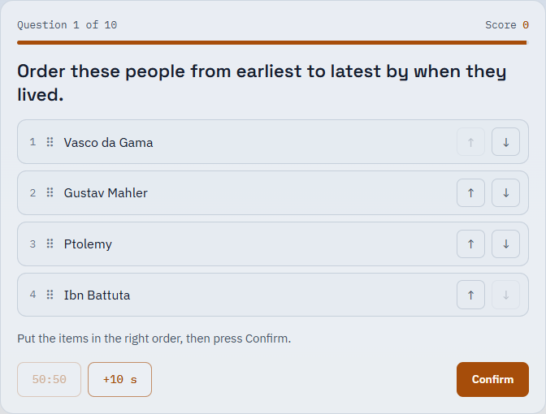
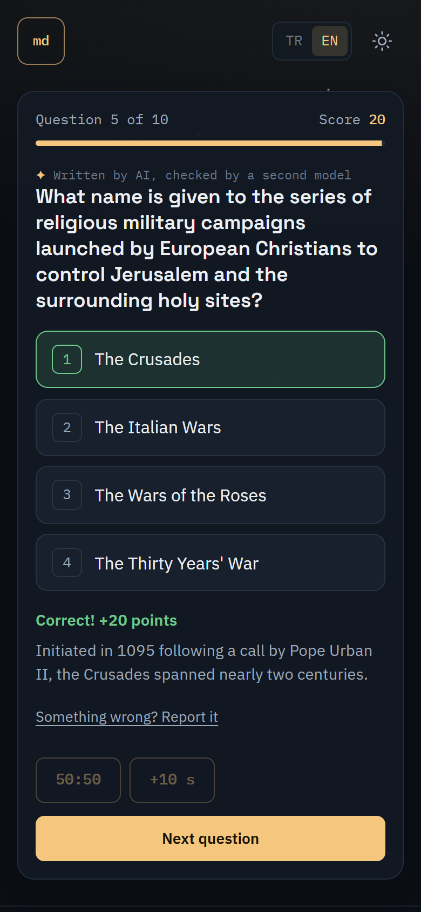
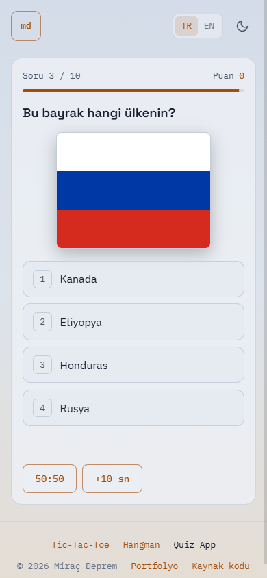
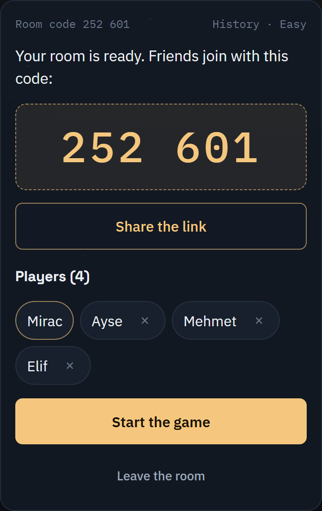
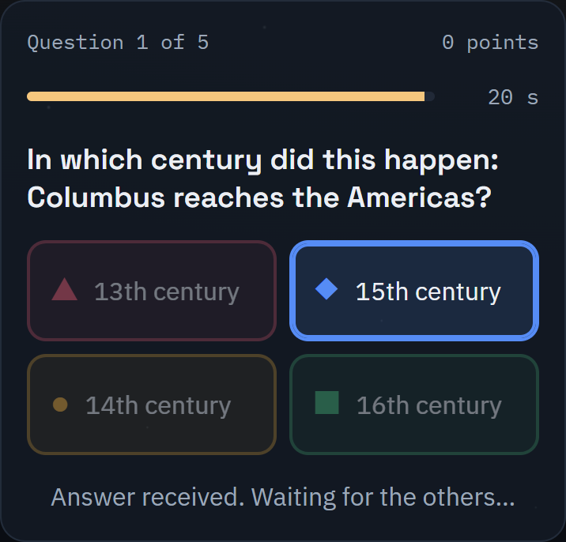
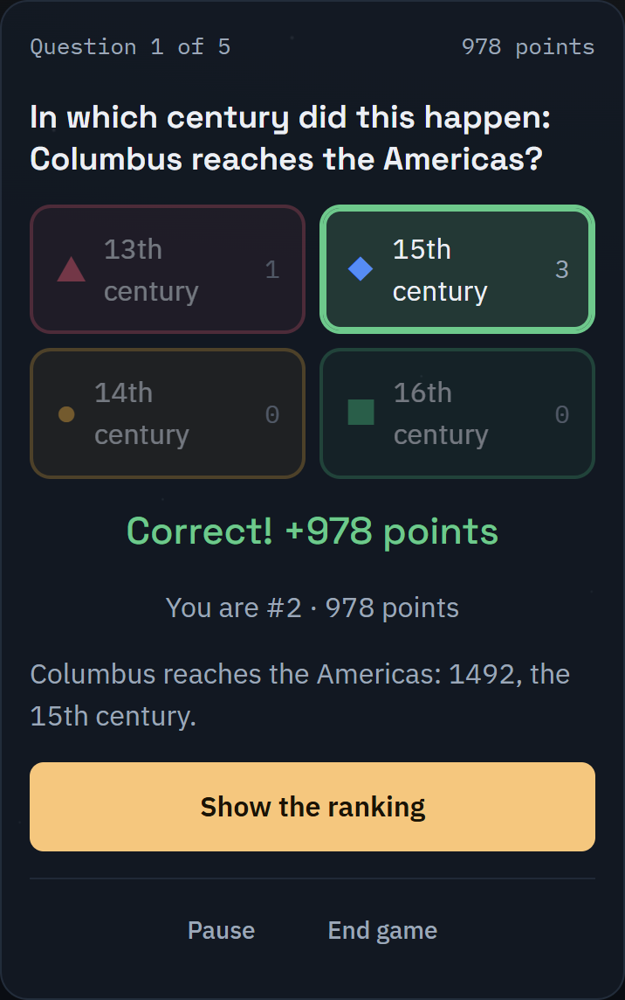
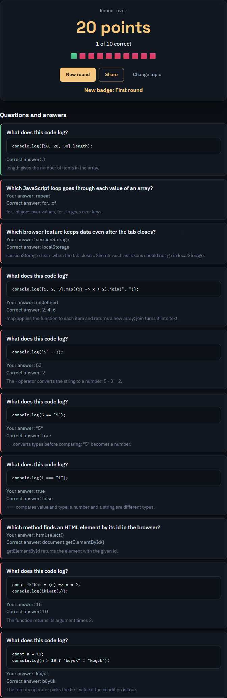

# Quiz App

**English** | [Türkçe](README.tr.md)

A free online quiz to test yourself, or to play with friends on your phones:
- Questions by category, in easy, medium and hard, plus a software track.
- Play with friends: create a room, share the code, and everyone answers the same question at the same time.
- A daily question that is the same for everyone.
- Thousands of questions generated from real data, and a pool of AI-written questions checked by a second model.

Answers never reach the browser before you answer, so the quiz cannot be cheated by opening the developer tools.

**Live demo:** [quiz.miracdeprem.com](https://quiz.miracdeprem.com)



## Features

- **Categories and three difficulties:** pick a category card, then Easy, Medium or Hard.
  - **General:** History, Geography, Science, Maths, Literature and Art, Sport, Film and Music, General Knowledge, or all of them mixed.
  - **Software:** Coding Basics, Algorithms, HTML and CSS, Python, JavaScript, SQL, Git, Web Security and C#, or all of them mixed.
- **Questions from three sources:**
  - **A hand-written bank of 796 questions** in Turkish and English, each with a short explanation. Every "what does this code print?" question was checked by actually running the code with Python, Node.js or .NET.
  - **Generated questions from real data.** Templates build new questions from people and rivers (Wikidata), 129 countries, mountains, famous works, chemical elements, World Cups and Olympic Games, historical events and discoveries. Maths questions get fresh numbers every time. Wrong options are always of the same kind, and a question is never built when two options could both be right.
  - **An AI question pool that grows every night.** A Vercel cron job asks Gemini for new questions in Turkish and English. Each one passes format checks (four distinct options, no "all of the above", no answer in the question, proper Turkish letters), then a second model (Groq) answers it without seeing the answer and judges whether it is accurate, unambiguous and well translated. Only questions that pass every check enter the pool. A round takes at most 3 of them; they are labelled, and a "Report" button removes a wrong one.
- **Four question types:**
  - Multiple choice.
  - Flag questions.
  - Chronological ordering, by drag and drop or with the ↑/↓ buttons.
  - "What does this code print?"
- **Rounds of 10 questions**
  - A timer and a speed bonus.
  - Two jokers: 50:50 and +10 seconds.
  - The correct answer and an explanation after every question, and a full review at the end.
- **An address for every category and difficulty:** for example [/matematik/kolay](https://quiz.miracdeprem.com/matematik/kolay) or [/python/zor](https://quiz.miracdeprem.com/python/zor) opens the quiz with that choice, in Turkish or English (`?lang=en`). Addresses of the first version, which used school levels, redirect to the matching difficulty.
- **No repeats:** questions you have already seen in a topic are not asked again until the pool runs out.
- **Daily question:** the same question for everyone, one try a day. The result can be shared to WhatsApp, X, LinkedIn, Telegram, Facebook or Instagram, or simply copied.
- **Progress, all stored in your own browser:**
  - Daily streak.
  - Accuracy statistics and the best score per category and difficulty, shown on the category cards.
  - 11 badges.
  - A **"My mistakes"** round that repeats the questions you got wrong until you get them right.
- **Turkish and English**, and a dark and a light theme matching [my portfolio](https://www.miracdeprem.com).
- **Accessible:**
  - Keys 1–4 to answer and Enter to continue.
  - Screen-reader announcements.
  - Respects "reduce motion".
- **Play with friends:** create a room, share the 6-digit code or link, and everyone answers the same question at the same time on their own phone.
  - The host chooses everything when creating the room: number of questions, time per question or no limit, manual or automatic advance, whether phones show the question (or only coloured answer buttons, for a classroom), whether phones show the right answer, a ranking after every question, a speed bonus, whether the host plays too and whether people can join late.
  - During the game the host can pause, skip a question, reveal early, end the game and remove a player.
  - Answers never reach the phones before the reveal, and points are calculated on the server.
- **Feedback:** a small button opens a form (name optional, email or phone, message) that sends straight to me through my portfolio site.

## How cheating is prevented

The whole quiz runs on the server (Vercel Functions).

| What | How |
|---|---|
| Answers | The question bank lives in a folder that is never served. The browser receives one question at a time, without its answer. |
| Round state | Kept in a token encrypted with **AES-256-GCM**: the browser holds it but can neither read nor change it. |
| Replaying a token | Every token works **once**. Upstash Redis remembers used ones, so you cannot send a fake answer, learn the right one and answer again. |
| Time and score | Measured and calculated on the server; the timer bar in the browser is only a display. |
| Flag images | Sent inside the question as data URLs, cleaned of any country code, so a file name cannot give the answer away. |
| Abuse | Rate limiting (120 requests per minute per IP), server-side validation of every field, a same-origin check (only the question of the day is also open to [miracdeprem.com](https://www.miracdeprem.com), which shows it on its home page, via an exact-origin CORS allow-list) and generic error messages. |

**Known limits.** There are no accounts, so some things cannot be enforced:
- The daily "one try" is per browser.
- Streaks and statistics live in local storage.
- The repository is public, so the question bank can be read on GitHub.

## Screenshots

| Home: categories, difficulty, daily question | A chronological ordering question (light theme) |
|---|---|
|  |  |

| An AI question with its label and the Report link | Flag question on a phone |
|---|---|
|  |  |

**Play with friends** (phones):

| The host's lobby | A player's question | The host's result screen |
|---|---|---|
|  |  |  |

<p align="center"></p>

## Tech Stack

- HTML, CSS, JavaScript (ES modules, no framework, no build step)
- Vercel Functions (Node.js) for the API and a nightly cron job, Upstash Redis (through its REST API, no SDK)
- Play with friends: a small Node.js server using only the built-in `http` module, Server-Sent Events to the phones and plain POST requests back; it runs on Oracle Cloud behind Caddy as a systemd service
- Gemini writes and Groq checks the AI questions (both called with `fetch`, no SDK)
- `node:crypto` for AES-256-GCM tokens and secure random numbers
- `node --test`: 213 unit tests
- **No npm dependencies** at all

## Installation

Play online at [quiz.miracdeprem.com](https://quiz.miracdeprem.com), or run it locally (Node.js 20.12 or newer).

1. Clone the repository:
   ```bash
   git clone https://github.com/MrcDprm/quiz-app.git
   cd quiz-app
   ```
2. Create a `.env` file. Copy `.env.example` and fill in `QUIZ_TOKEN_KEY` with a random key:
   ```bash
   node -e "console.log(require('crypto').randomBytes(32).toString('base64'))"
   ```
   Keep `QUIZ_DEV=1` to use an in-memory store instead of Redis. The AI pool is optional: without `GEMINI_API_KEY` and `GROQ_API_KEY` the quiz simply uses the bank and the templates.
3. Start the local server:
   ```bash
   npm run dev
   ```
4. Open `http://localhost:5173`. The development server serves `public/` and runs the same API functions that Vercel runs.

Run the tests with:
```bash
npm test
```

Try the AI pool for one category and difficulty (needs the two keys; nothing is saved):
```bash
node scripts/ai-preview.mjs history medium
```

To try playing with friends locally, start the room server next to `npm run dev` (keep `LIVE_ORIGINS=http://localhost:5173` in `.env`):
```bash
npm run live
```

### Project structure

```
public/                 The only folder that is served: page, styles, browser modules
  src/main.js           Screens, timer, answers, results
  src/progress.js       Statistics, mistakes list, seen questions, badges
  src/storage.js        Settings in localStorage, validated on every read
api/                    Vercel Functions: round, daily, review, answer, joker, report, page (serves every address with its own title)
  cron/refill.js        Nightly job that fills the AI pool
lib/
  quiz.js               Round rules: timing, scoring, jokers
  token.js              AES-256-GCM round tokens
  store.js              Single-use tokens and rate limiting (Upstash REST or memory)
  http.js               Validation, origin check, rate limit, generic errors
  catalog.js            Loads the bank, mixes bank and generated questions, skips seen ones
  generators.js         Template engine; templates/ has people, countries, works, elements, maths, sport, rivers, mountains, events, discoveries
  ai/                   AI pool: prompts, model calls, format checks, the pool in Redis, the nightly refill
data/                   Question bank, data for the generators, flags and the page template app.html (never served)
live/                   Room server for playing with friends: rooms.js (game rules), server.js (HTTP and events), questions.js
scripts/                Local server, the Wikidata fetch script and the AI pool preview
tests/                  Unit tests
```

## What I Learned

- **Never trusting the browser.** At first I planned to send the questions with their answers. Then I realised anyone could open the network tab and read them. So I moved the rules, timing and scoring to the server, and the browser only shows one question at a time. Even the random seed used to shuffle the options stays secret, because with the seed and the open-source code the answer could be worked out.
- **Stateless servers with encrypted tokens.** Instead of keeping each round in a database, I encrypt the round state with AES-256-GCM and hand it to the browser. GCM both hides the data and detects any change. To stop the same token being used twice, I store its ID once in Redis with `SET ... NX`, which is atomic.
- **Seeded randomness.** With a small seeded generator (mulberry32) the same seed always gives the same shuffle. That made the tests repeatable and gave me the daily question for free: the date becomes the seed, so everyone gets the same question without storing it anywhere.
- **Generating questions from data.** I wrote a script that pulls famous people from Wikidata with SPARQL. I also learned how to make generated questions fair: wrong options are picked from the same kind of thing, and a question is skipped if two options could both be right.
- **Testing what I write.** Every code question is run for real before it goes into the bank; this caught several of my own mistakes. A test that checks browser module imports caught a file I had committed empty.
- **Pointer Events.** One set of pointer events handles mouse, touch and pen for drag and drop. The ↑/↓ buttons stay for keyboard and screen-reader users.
- **Real-time without WebSockets.** The phones only need to hear from the server, so Server-Sent Events were enough: the browser reconnects by itself and Node's built-in `http` module serves them, so the project still has no dependencies. Answers go back as ordinary POST requests. Vercel functions cannot keep connections open, so this server runs on an always-on Oracle Cloud machine behind Caddy.
- **Testing with a fake clock.** The room logic takes the time as an argument, so tests can jump 60 seconds ahead and check that a paused question does not run out, or that the speed bonus stays fair after a pause. Playing a whole game with three browser windows found two bugs the unit tests could not: a reload signed the player out, and a tap right after typing a name was lost.
- **Not trusting a model either.** The first AI questions were written in Turkish without Turkish letters, and one called Charlemagne the founder of the Holy Roman Empire, which historians dispute. The checking model had approved both. So I added a code check for Turkish letters, asked the checker whether every statement is accurate and told it to reject when in doubt. Now it turns down about half of the hardest questions. The checker is always a different model from the writer.
- **Building without dependencies.** Redis, Gemini and Groq are all called through their REST APIs with `fetch`. There is nothing to install and no vulnerable package to update.

## Credits

- Data about people and rivers: [Wikidata](https://www.wikidata.org) (CC0). Countries, mountains, works, elements, sport, events and discoveries are curated by hand.
- Flags: [flag-icons](https://github.com/lipis/flag-icons) by Panayiotis Lipiridis (MIT); the licence is in `data/flags/LICENSE`.

## Future Plans

- Accounts, so streaks and statistics follow you across devices and the daily question can have a leaderboard.
- AI-generated rounds on any topic you type in, built from the same checked pool process.
- More specialist areas besides software.
- Verifiable result links for sharing.

## License

[MIT](LICENSE)
